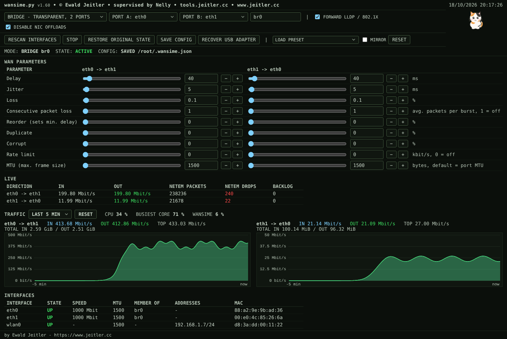
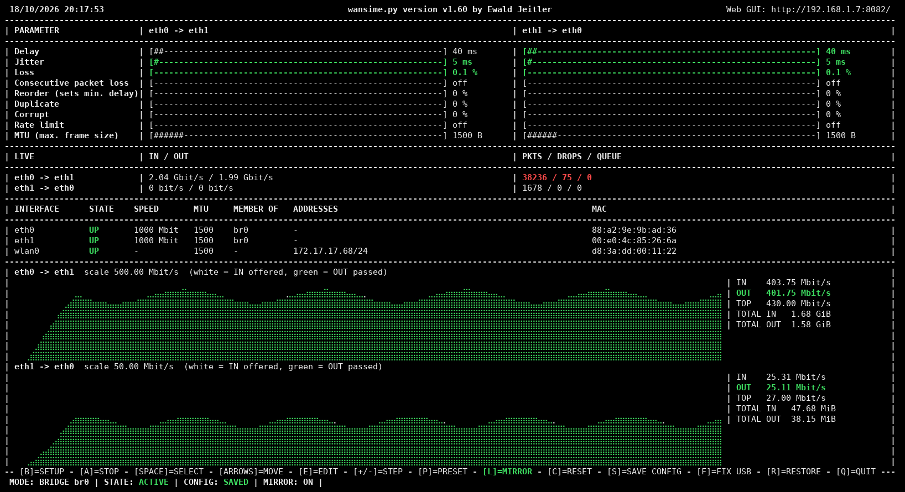

# wansime — WAN Simulation made easy

Single-file Python tool (standard library only) that simulates WAN links on Linux with `tc netem`: delay, jitter, loss, reorder, duplicate, corrupt, rate limit and MTU per direction. Runs as a transparent L2 bridge between two Ethernet ports or on a single interface. Control via curses TUI and web GUI (port 8082) at the same time.

By Ewald Jeitler - https://www.jeitler.cc

Current version: v1.63

## Features

- Bridge mode (A <-> B, impairments per direction) and single-interface mode (egress + IFB ingress)
- Delay, jitter, loss, consecutive loss, reorder, duplicate, corrupt, rate limit, MTU
- START / STOP without removing the setup; restore of the original network state
- Live apply of changes (debounce 0.6 s)
- Bridge passes VLAN, STP, CDP, VTP, LLDP, 802.1X
- Live IN / OUT traffic graphs, CPU load, interface table
- USB NIC watchdog and recovery (RTL8153 / `r8152`)
- systemd service (headless)
- Python 3.8+, Linux (Raspberry Pi 5), root required

## Installation / Update

```
/bin/bash -c "$(curl -fsSL https://raw.githubusercontent.com/ewaldj/wansime/main/e-install.sh)"
```

Installs `wansime.py` to `/usr/local/bin` as command `wansime`; running it again updates. Manual: download `wansime.py` from https://github.com/ewaldj/wansime, `chmod +x wansime.py`.

### Requirements

```bash
sudo wansime --install      # iproute2, ethtool, kernel modules sch_netem, bridge, ifb (apt-get / dnf / yum)
```

The script checks the requirements at every start and offers to install missing ones (`Install now? [Y/n]`); without a terminal it only reports them and exits. Without root it restarts itself through `sudo` (interactive terminal only).

## Screenshots





Example values, simulated traffic.

## Quick Start

```bash
sudo wansime                    # TUI + web GUI on http://<ip>:8082/
sudo wansime --install-service  # systemd service wansime.service (headless)
sudo wansime --restore          # restore the original network state
```

Workflow: setup (TUI `b` / web setup row) -> START -> change values -> STOP / START -> restore original state.

## Modes

| Mode | Function |
|------|----------|
| **bridge** | L2 bridge `br0` between port A and B. A->B is shaped on the egress of port B, B->A on the egress of port A. |
| **single** | One interface, no bridge. **OUT** = egress shaping, **IN** = ingress redirected to an IFB device. |

## Parameters (per direction)

| Parameter | Range | Note |
|-----------|-------|------|
| Delay | 0-1000 ms | typeable up to 60000 |
| Jitter | 0-500 ms | normal distribution, needs a base delay |
| Loss | 0-20 % | random |
| Consecutive packet loss | 1-50 | average burst length, 1 = independent loss (Gilbert-Elliott); Loss stays the overall rate |
| Reorder | 0-50 % | needs a delay |
| Duplicate | 0-20 % | |
| Corrupt | 0-20 % | |
| Rate limit | kbit/s, 0 = off | TUI accepts `512k`, `20m`, `1g` |
| MTU | 576-9100 B, default = port MTU | |

- Jitter > 0 with delay 0: delay is set to the jitter value (tc rejects `delay 0ms 10ms distribution normal`).
- Jitter makes packets overtake each other, so out-of-order packets appear even with Reorder = 0.
- Reorder > 0 with delay < 10 ms: delay is raised to 10 ms.
- Queue limit is derived from delay and rate.
- MTU, bridge: both ports get the largest configured MTU (never below the original). A direction with a smaller MTU is limited by a tc filter on its egress port that drops frames larger than MTU + 14 byte without ICMP (PMTUD black hole). Use with NIC offloads disabled. USB adapters are taken down for an MTU change; if one stops responding, the USB recovery re-initializes it and re-applies the MTU.
- MTU, single: the interface MTU is set (OUT value only).
- Mirror (TUI `l`, web MIRROR): edits are copied to the other direction.

### Presets

Delay and jitter are one-way per direction: RTT = A->B delay + B->A delay. Rate per direction, A->B = upstream. Presets keep the MTU setting.

| Preset | Delay A->B / B->A | Jitter | Loss | Rate A->B / B->A | Other |
|---|---|---|---|---|---|
| Baseline: no impairment | 0 / 0 ms | 0 | 0 | - | |
| RTT 20 ms, jitter 1 ms, loss 0.01 % | 10 / 10 ms | 1 ms | 0.01 % | - | |
| RTT 100 ms, jitter 3 ms, loss 0.1 % | 50 / 50 ms | 3 ms | 0.1 % | - | |
| RTT 300 ms, jitter 8 ms, loss 0.1 % | 150 / 150 ms | 8 ms | 0.1 % | - | |
| RTT 30 ms, jitter 2 ms, 1M up / 16M down | 15 / 15 ms | 2 ms | 0 | 1 / 16 Mbit/s | ADSL2+ 16/1 |
| RTT 70 ms, jitter 10 ms, loss 0.3 %, 10M up / 40M down | 35 / 35 ms | 10 ms | 0.3 % | 10 / 40 Mbit/s | LTE |
| RTT 600 ms, jitter 10 ms, loss 0.5 %, 5M up / 20M down | 300 / 300 ms | 10 ms | 0.5 % | 5 / 20 Mbit/s | GEO satellite |
| RTT 80 ms, jitter 30 ms, loss 2 %, reorder 1 %, 10M/10M | 40 / 40 ms | 30 ms | 2 % | 10 / 10 Mbit/s | reorder 1 % |

## Start / Stop

- START: sets up bridge (or IFB) and applies the values.
- STOP: setup stays, all traffic is dropped (`netem loss 100 %`); state `STOPPED - NO TRAFFIC`. Value changes while stopped are stored and applied on START.
- Restore removes netem, bridge / IFB and restores the ports. To change ports or mode: restore, change, START.

## Applying values

Changes (slider, number field, `-` / `+`, cursor keys) are applied 0.6 s after the last change, one tc update per burst of changes. While a setup is active every edit is applied; FORWARD LLDP / 802.1X and DISABLE NIC OFFLOADS also take effect immediately. Unchecking offloads restores the NIC features saved before the setup.

## TUI

| Key | Action |
|-----|--------|
| Arrows | select parameter / direction |
| Enter, `e` | edit value |
| `+` `-` / `]` `[` | step / step x10 |
| `Space` | select value: Up/Down jump between values, Left/Right change it (PgUp/PgDn x10), Tab switches column; Space / Enter / Esc leaves |
| `l` | mirror |
| `p` | load preset |
| `b` | setup: mode, interfaces |
| `a` | START / STOP |
| `r` | restore original state |
| `c` | reset all impairments and MTU |
| `s` | save config |
| `f` | re-initialize USB adapter(s) of the active setup |
| `q`, Ctrl-C | quit; with an active setup: "Reset system (restore original state)?" - `y` / Enter = restore and quit, `n` = quit, keep state |

Layout adapts to the terminal (minimum 80 columns). Top to bottom: parameter table, LIVE, INTERFACES, two traffic graphs (at least 9 free rows), key bar, status line (mode, state, config SAVED / MODIFIED, mirror, messages). Red OUT value = traffic comes in, nothing goes out.

## Web GUI

Port 8082 (`--port`). Buttons: RESCAN INTERFACES, START / STOP, RESTORE ORIGINAL STATE, SAVE CONFIG, RECOVER USB ADAPTER, LOAD PRESET, MIRROR, RESET. Checkboxes: FORWARD LLDP / 802.1X, DISABLE NIC OFFLOADS. Sections: WAN PARAMETERS, LIVE (IN / OUT rate, netem packets / drops / backlog), TRAFFIC, INTERFACES.

No login by default: use `--auth USER:PASS` (or env `WANSIM_AUTH`) and/or `--bind 127.0.0.1`.

HTTP API (JSON): `GET /api/state`, `GET /api/hist?since=<ts>`; `POST` with `Content-Type: application/json`: `/api/cfg`, `/api/apply`, `/api/stop`, `/api/clear`, `/api/preset`, `/api/recover`, `/api/restore`, `/api/save`, `/api/histreset`.

## Traffic graphs

Port counters are sampled once per second (30 min history, kept in the process). Per direction: IN = arriving traffic, OUT = traffic passing the simulation; the difference is removed by loss, rate limit and drops.

- Web GUI: range 1 / 5 / 15 / 30 min, current values, peak, totals. RESET clears history and totals on the server.
- CPU (behind RESET): whole system, busiest core, wansime process (percent of one core); above 80 % red. Forwarding can saturate a single core (soft IRQ) while the total stays low.
- TUI: braille graphs (white = IN, green = OUT) with IN, OUT, TOP and totals. Needs a UTF-8 locale, otherwise `#` / `.`.

## Transparency of the bridge

STP off, IGMP/MLD snooping off, no IP address on `br0`, IPv6 disabled on it.

| Protocol | Passes? |
|---|---|
| VLAN tags (802.1Q, QinQ) | yes |
| STP / RSTP / MSTP BPDUs (01-80-C2-00-00-00) | yes, flooded (STP off) |
| CDP, VTP, DTP, UDLD, PAgP, PVST+ (01-00-0C-CC-CC-xx) | yes, ordinary multicast |
| LLDP (01-80-C2-00-00-0E), 802.1X EAPOL (01-80-C2-00-00-03), other link-local | yes with FORWARD LLDP / 802.1X (default; `group_fwd_mask 0xfff8`) |
| 802.3x pause (01-80-C2-00-00-01) | no, handled by the NIC |
| LACP / slow protocols (01-80-C2-00-00-02) | no, a Linux bridge cannot forward them |

Offloads (gro/gso/tso/lro) are disabled on the bridge ports by default (config key `offloads_off`).

## Persistence and restore

- Config: `/etc/wansim/config.json` (TUI `s` / web SAVE CONFIG).
- Snapshot of the original state: `/var/lib/wansim/original.json`, written before the first change. Restore removes netem, bridge / IFB and restores IP addresses, routes, MTU, offloads and the NetworkManager managed state: `sudo wansime --restore`.
- If the bridge cannot be removed the snapshot is kept; restore can be repeated.
- `--apply` applies the saved config once and exits.

## USB adapter recovery

USB adapters (e.g. RTL8153 / `r8152`) are checked every few seconds while a setup is active. If `ethtool` reports "No such device" for about 6 s, the USB device is re-authorized (like unplug/replug), the driver module is reloaded if needed, the port is put back into the bridge (or IFB redirect) and the WAN values are re-applied. Maximum 3 automatic attempts per 10 minutes. Manual: web RECOVER USB ADAPTER, TUI `f`. Non-USB ports are not touched.

## Single instance

At start other running copies (also `wansim.py`) are listed; `k` kills them, `a` aborts (default). Without a terminal it exits with an error; `--kill-old` kills without asking. The `wansime.service` is stopped via `systemctl`. Killing a process does not change the network state; use `--restore`.

## Command line

```
wansime.py [--daemon] [--no-web] [--port 8082] [--bind 0.0.0.0] [--auth USER:PASS]
          [--install] [--install-service] [--remove-service]
          [--apply] [--restore] [--status] [--all-ifaces] [--kill-old] [--version]
```

| Option | Description |
|---|---|
| `--daemon` | Headless, web GUI only (default without terminal) |
| `--no-web` | TUI without web GUI |
| `--port`, `--bind` | Web port (default 8082), bind address (default 0.0.0.0) |
| `--auth USER:PASS` | HTTP basic auth (or env `WANSIM_AUTH`) |
| `--install` | Install required packages / kernel modules |
| `--install-service`, `--remove-service` | Install and start / stop and remove `wansime.service` |
| `--apply` | Apply the saved config once and exit |
| `--restore` | Restore the original state and exit |
| `--status` | Print the current state and exit |
| `--all-ifaces` | Also list virtual Ethernet interfaces |
| `--kill-old` | Stop other instances without asking |
| `--version` | Print the version |

## Notes

- Bridge mode flushes the IP configuration of both ports and sets NetworkManager ports to unmanaged. Use a third interface for management; if a port carries your session or the default route, the TUI / web GUI asks for confirmation.
- Single mode impairs all traffic of the interface, including your own management session.
- System commands have a timeout of 8-15 s; a hanging NIC produces an error and state `busy` instead of blocking the UI.

## Project structure

```
├── wansime.py            # simulator: TUI + web GUI + bridge / netem control
├── e-install.sh          # installer / updater
├── screenshots/          # images for this README
├── LICENSE
└── README.md
```
